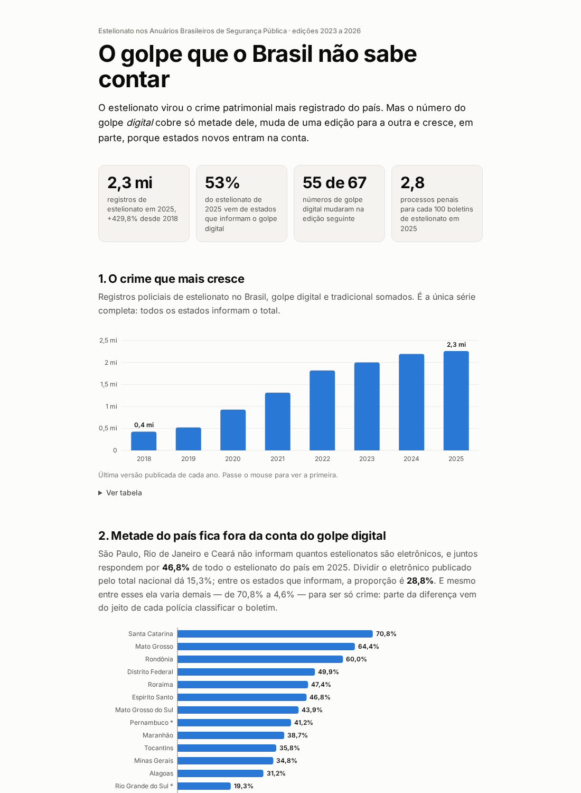

# O golpe que o Brasil não sabe contar

Pipeline com **dbt** e **DuckDB** que lê as planilhas de quatro edições do **Anuário Brasileiro de Segurança Pública** (2023 a 2026) e pergunta o que elas conseguem dizer sobre o estelionato eletrônico: quanto do país o número cobre, quanto ele muda de uma edição para a outra e quanto do crescimento é golpe novo e quanto é estado novo entrando na conta.

**📊 Página:** https://luissfellipe.github.io/estelionato-digital/ · **dbt docs:** https://luissfellipe.github.io/estelionato-digital/dbt/



> Em 2025, o estelionato eletrônico publicado cresceu **21,1%**. Nos 18 estados que informam o dado desde 2021, sem quebra de série, cresceu **11,1%**: metade da alta é Pernambuco, que só começou a contar a fraude eletrônica em dezembro de 2024.

Projeto independente, feito com dados públicos do Fórum Brasileiro de Segurança Pública e sem vínculo com ele.

## Arquitetura

```
FBSP (site + repositório DSpace)
   │  ingest/baixar.py      4 planilhas .xlsx, uma por edição (baixa só o que falta)
   ▼
data/bruto/anuario-{2023..2026}.xlsx
   │  ingest/extrair.py     acha a tabela pelo título, resolve o cabeçalho em três
   │                        linhas, separa as notas de rodapé, "..." vira nulo
   ▼
data/bronze/*.parquet ──► dbt (DuckDB) ──► data/estelionato.duckdb
                          staging → marts      │  export/exportar.py
                                               ▼
                                       site/data/dados.json ──► GitHub Pages
```

| Camada | Objeto | Descrição |
|---|---|---|
| bronze | `estelionato_uf.parquet` | Um valor por edição, UF, ano, crime e medida, com a linha da planilha e as notas |
| bronze | `notas`, `serie_nacional`, `funil` | Texto das notas de rodapé; série do Brasil desde 2018 (painel); boletins, processos e presos |
| staging | `stg_anuario__estelionato` | Edição × UF × ano × crime, com registros e taxa lado a lado |
| marts | `fct_estelionato` | A última versão de cada UF, ano e crime |
| marts | `fct_revisoes` | Os anos publicados em duas edições, com a versão original e a revisada |
| marts | `fct_cobertura_eletronico` | Quantos estados informam o eletrônico e que parte do total eles somam |
| marts | `fct_eletronico_base_fixa` | Crescimento com a mesma base de estados, ao lado do total publicado |
| marts | `fct_participacao_eletronico`, `fct_serie_nacional`, `fct_funil` | Parte eletrônica por estado; série nacional; funil da punição |
| seed | `quebras_de_serie` | As quatro quebras na série do eletrônico, com a fonte de cada uma |

## O que os dados mostram

**1. O estelionato é o crime que mais cresce.** De 426.799 registros em 2018 para **2.261.055 em 2025** (+429,8%). É a única série completa: todos os estados informam o total.

**2. O golpe digital cobre metade do país.** São Paulo, Rio de Janeiro e Ceará não informam quantos estelionatos são eletrônicos, e somam **46,8%** do estelionato de 2025. Os 346.753 casos eletrônicos parecem ser 15,3% do total; entre os estados que informam, são **28,8%**. A taxa nacional do Anuário já usa só a população desses estados (141 milhões); o erro está em ler o número absoluto como se fosse do país.

**3. A proporção varia demais para ser só crime.** Em Santa Catarina, 70,8% do estelionato é registrado como eletrônico; em Goiás, 7,1%; no Paraná, 7,2%. Parte da diferença vem do jeito de cada polícia classificar o boletim.

**4. O número muda depois de publicado.** Dos 67 números estaduais de estelionato eletrônico publicados em duas edições, **55 mudaram** na seguinte, 13 deles em 10% ou mais. No total de estelionato, 65 de 81 mudaram, mas só 5 em 10% ou mais. Exemplos:
- **Pará, 2023:** 16.884 → 1.686 (−90%). Mudança de filtro, explicada em nota.
- **Amazonas, 2024:** 6.035 → 972 (−84%), **sem nota**, enquanto 2023 continua em 3.829.
- **Pernambuco:** a edição 2024 publicou 14.164 e 13.941 para 2022 e 2023; a edição 2025 diz que a fraude eletrônica só passou a ser contada no estado em dezembro de 2024. Os +4.384% de 2025 são o começo da contagem.

**5. Parte do crescimento é estado novo.** A Bahia entra em 2022, Rio Grande do Norte e Rio Grande do Sul em 2023, e Pernambuco some e volta. Com a mesma base de 18 estados, o eletrônico cresceu 11,1% em 2025, contra 21,1% do total publicado. O crescimento existe: nesses estados, o eletrônico passou de 20,1% para 33,3% do estelionato entre 2021 e 2025.

**6. Quase ninguém responde.** Em 2025, 2.261.055 boletins, 63.771 processos penais (2,8 por 100 boletins) e 4.819 presos (0,2 por 100). Processos e presos de um ano não são os casos daquele ano: a razão compara volumes.

## Decisões técnicas

- **A tabela é achada pelo título, não pela aba.** O estelionato é a T15 em 2023 e 2024, a T19 (com o título "Tabela 15") em 2025 e a T17 em 2026. O extrator procura "Estelionato e Estelionato por meio eletrônico" nas primeiras linhas de cada aba e falha se achar zero ou duas.
- **Cabeçalho resolvido, não posicional.** As colunas saem do cruzamento das três linhas do cabeçalho (crime, medida, ano), com o rótulo mesclado repetido à direita. Algumas edições têm uma linha em branco no meio do cabeçalho, e o extrator pula essa linha.
- **"..." não é zero.** Vira nulo com `situacao = 'nao_informado'`. Somar como zero esconderia que metade do país está fora.
- **As duas versões ficam.** Cada ano do meio da série é publicado duas vezes, e a bronze guarda as duas. Os marts usam a última versão, e `fct_revisoes` compara as duas.
- **Quebras de série num seed, não numa regra.** Pará, Pernambuco e Rio Grande do Sul têm quebra documentada em nota. O Amazonas foi achado pelas revisões. Ficam em `seeds/quebras_de_serie.csv`, com o motivo, e saem da base fixa.
- **Testes que conferem o Anuário, não só o código.** Além de unicidade e valores aceitos, o dbt confere que a linha Brasil é a soma das UFs, que as taxas do total e do eletrônico usam a mesma população e que o painel e a tabela dão o mesmo número para o Brasil.
- **Achado de passagem:** na edição 2026, o ano 2024 aponta para a nota "(5)", que não existe (a tabela vai até a 4). A nota certa é a (3), "Atualização das informações publicadas no Anuário... ano 19, 2025".

## Como rodar

Precisa só do [uv](https://docs.astral.sh/uv/).

```bash
make pipeline   # baixa, extrai, roda o dbt (seeds, 11 modelos e 19 testes) e exporta o JSON
make docs       # documentação do dbt em site/dbt/
make site       # página em http://localhost:8003
```

O GitHub Actions roda o mesmo pipeline a cada push e publica `site/` no GitHub Pages.

## Limites

São registros policiais, não crimes. A pesquisa de vitimização do próprio Fórum estima 26,3 milhões de vítimas de golpe pela internet ou celular em um ano (Anuário 2026, p. 123), mais de dez vezes o número de boletins. "Estelionato por meio eletrônico" é a fraude eletrônica do art. 171, §§ 2º-A, 2º-B e 3º do Código Penal, criada pela Lei 14.155/2021. A edição 2022 do Anuário só saiu em PDF, então a série por UF começa em 2021, pela edição 2023.
